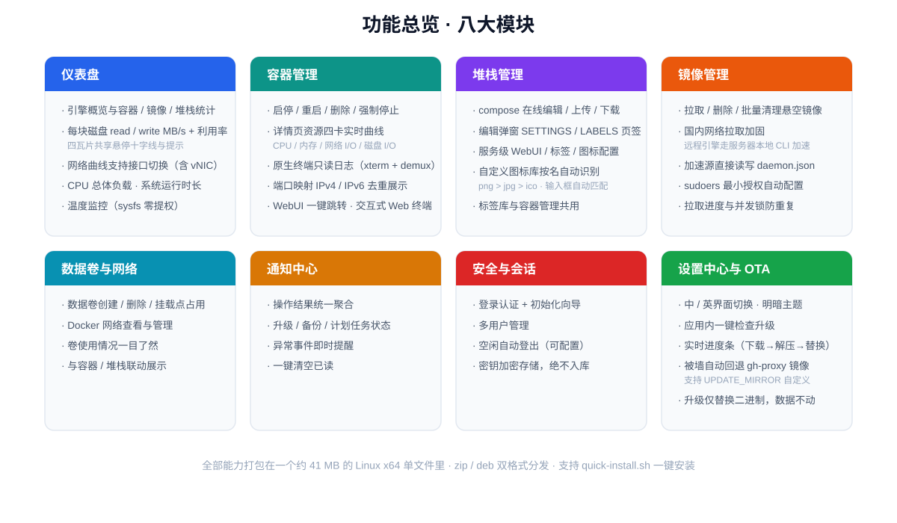
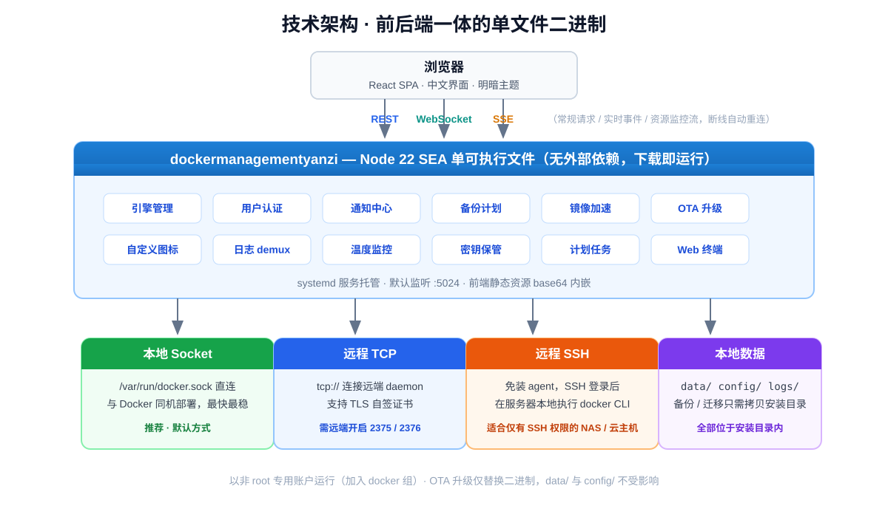

<div align="center">


**面向自建 NAS / 服务器的一体化 Docker 可视化管理面板（中文界面）**

单文件二进制 · 轻量部署 · 多引擎接入 · 应用内一键在线升级（OTA）


</div>

---

## 目录

- [项目背景](#项目背景)
- [功能总览](#功能总览)
- [页面功能导览](#页面功能导览)
- [技术架构](#技术架构)
- [安装与部署](#安装与部署)
- [常见问题](#常见问题)
- [目录结构（安装后）](#目录结构安装后)
- [说明](#说明)

---

## 项目背景

- 作者此前在 **Unraid** 上用其自带的 **Compose（堆栈）组件**管理容器，形成了以「堆栈」为中心的使用习惯。
- 后来 NAS 换成了**飞牛（fnOS）**，对原生 Docker 的命令行与配置方式不习惯，也缺少一个顺手的、以堆栈为核心的图形化管理界面。
- 于是**以 Unraid 的 Compose 交互为蓝本**开发了本项目：把熟悉的「堆栈」工作流（列表 → 编辑 → 启停 → 日志）带出来，做成单文件部署、中文界面、可接入多台主机的通用 Docker 管理面板——飞牛、Unraid 或任何 Linux 主机都能跑。

---

## 功能总览



---

## 页面功能导览

> 顶部导航共 8 个页面：**仪表盘 / 容器管理 / 堆栈管理 / 镜像管理 / 数据卷管理 / 网络管理 / 通知中心 / 设置中心**，另含登录页与容器详情页。逐页介绍如下。

### 登录页与初始设置

- 左侧深海军蓝品牌区：主视觉插画、功能亮点列表；右侧登录表单；首次使用自动进入**初始设置向导**创建管理员账号。
- 多用户管理、密码修改、**找回码**自助恢复凭据、双重验证；空闲自动登出（超时可配置）。
- 中 / 英文界面切换、明暗主题。

### 仪表盘

整机 + 容器全局总览，资源数据实时推送（服务端 1s 聚合，多标签页共享一条 SSE）：

| 磁贴 | 内容 |
|---|---|
| **处理器** | CPU 总负载曲线 + 逐核占用条，宿主机型号标识，时长可切换 |
| **内存** | 已用 / 总量曲线，区分系统占用与 Docker 占用 |
| **显卡** | GPU 型号、利用率、温度曲线（有显卡时显示） |
| **容器** | 图标卡片墙：容器图标 / 名称 / 状态，一键跳转容器管理 |
| **容器资源监控** | 选中容器的 CPU / 内存实时曲线，刷新间隔与时长可调 |
| **堆栈 / 镜像** | 堆栈运行数、镜像总数 + 悬空 / 未使用分类统计，一键跳转 |
| **网络** | 上 / 下行速率曲线，网卡可切换（物理网卡 + Docker vNIC） |
| **磁盘** | 每块盘独立 `read / write MB/s` 曲线 + 利用率百分比，支持按盘筛选 |

- 四张资源磁贴均为**实时曲线 + 共享悬停十字线与提示框**，卡片可折叠，折叠时保留关键指标。
- 温度监控接入 `coretemp` / `k10temp` / `zenpower` / `cpu_thermal` / `drivetemp` 等 sysfs 监控点，**零提权**。

### 容器管理

所有容器的平面清单，日常操作最频繁的页面：

- **搜索 + 状态筛选**（运行中 / 已停止 / 已暂停）；「列」可自定义显示列，「导出」导出容器清单。
- **每行信息**：图标（自动匹配）、容器名、运行状态、**标签**（彩色胶囊，与全局标签库共用）、**所属堆栈**、网络模式（bridge / host）、运行时长（含 healthy 健康标记）。
- **行尾球形按钮**：一键打开该容器 WebUI（端口自动识别）。
- 右键菜单统一操作：启停 / 重启 / 删除 / 强制停止（中英文随界面切换）。
- **容器详情页**：
  - 资源监控四卡（CPU / 内存 / 网络 I/O / 磁盘 I/O）实时曲线，时间窗口可调（默认 30 秒）；
  - 原生终端日志：只读 xterm 渲染，完整保留 ANSI 颜色，服务端按 Docker 8 字节帧头**字节级 demux**，无乱码；
  - 端口映射展示（宿主机：容器/协议，IPv4 / IPv6 去重）；
  - 交互式 Web 终端：浏览器内直接进入容器或宿主机执行命令。

### 堆栈管理

以 **docker-compose 堆栈**为中心的管理（交互蓝本来自 Unraid Compose）：

- 堆栈列表：状态、标签、**容器数（运行/总数）**、运行时长、更新检测状态。
- **新建堆栈**：在线编辑 / 上传 compose 文件创建。
- **编辑弹窗**多页签：
  - **COMPOSE**：yaml 在线编辑（高亮）、上传、下载；
  - **SETTINGS**：堆栈名称、描述、标签（与容器管理共用标签库）、图标、开机自启等配置；
  - **LABELS**：按服务逐个配置 WebUI 地址 / 端口、默认 Shell、描述、标签与图标。
- 整栈启停 / 重建 / 更新 / 删除；堆栈日志弹窗（xterm 只读终端，无乱码）。
- **自定义图标库**：设置中心绑定服务端图标目录后，按堆栈 / 容器 / 服务名自动匹配图标（`png > jpg > ico`）；**图标输入框输入名称即实时过滤图库**，下拉点选即套用。未绑定目录时自动回退堆栈自带 `icon.*` 方案，完全兼容。

### 镜像管理

- 镜像列表按 **本地镜像 / 未使用 / 悬空** 分类统计，支持搜索。
- 拉取镜像（进度实时显示、并发锁防重复）、删除、批量清理悬空镜像。
- **镜像保护标记**：常用镜像可标记「不被清理」，防止批量清理误删。
- **导入镜像**：上传 tar 包离线导入（适合无外网环境）。
- **镜像更新检查**：后台定时检查镜像新版本，发现更新推送通知中心。
- **国内拉取加固**：本地引擎走 `docker pull` CLI；远程 SSH / TCP 引擎由**服务器本地** daemon 的 `registry-mirrors` 加速。

### 数据卷管理

- 数据卷列表：卷名、驱动、创建时间、**关联容器**交叉展示，支持搜索。
- 创建 / 删除 / **批量删除**数据卷；「全部未关联卷」快速筛选孤儿卷。
- **导出快照**：把卷内容打包导出备份。

### 网络管理

- Docker 网络列表：网络名、驱动（bridge / host / macvlan / null）、关联容器，支持搜索与标签。
- 新建网络（驱动、子网等参数可选）/ 删除网络。

### 通知中心

- 操作结果、镜像更新、备份与计划任务、容器停止 / 异常等事件的**统一聚合**。
- 持久化事件日志，支持**滚动加载历史**；通知搜索、一键清空当前显示。

### 设置中心

左侧 12 个分区，集中管理全局配置：

| 分区 | 功能 |
|---|---|
| **用户** | 多用户管理、修改密码、找回码 |
| **列显隐** | 各列表页显示列自定义 |
| **引擎配置** | 多引擎接入管理（见下）、**Docker 全局配置**：镜像加速源直接读写 `daemon.json` 的 `registry-mirrors`（保留其余配置项），内容变化后询问重启 Docker |
| **标签管理** | 全局标签库增删改（彩色标签，容器 / 堆栈 / 镜像等各页共用） |
| **编辑堆栈** | compose 默认编辑器等堆栈编辑偏好 |
| **页面设置** | 弹窗、半页面宽度、日志行数、仪表盘默认网卡、**自定义图标库目录绑定** |
| **镜像更新** | 后台定时检查镜像更新的调度配置（星期几 / 时间点） |
| **备份管理** | **三级备份策略（周 / 月 / 年）**：自动打包堆栈与配置、按档位保留清理、下载备份、**上传备份并恢复** |
| **通知** | Webhook 通知、通知展示偏好 |
| **日志** | 应用运行日志在线查看（末 200 / 2000 行） |
| **硬件信息** | 设备识别（主板 / 序列号 / DMI）、硬件监控点状态 |
| **系统更新** | 应用内 OTA：一键检查更新 + 升级，实时进度条，国内自动回退 gh-proxy.com 镜像（详见下方「多引擎接入」与 FAQ） |

### 多引擎接入（全局）

统一管理多台 Docker 主机，右上角引擎切换器随时切换，所有页面均按当前引擎展示数据：

| 方式 | 说明 | 适用场景 |
|---|---|---|
| **本地 Socket** | 直连 `/var/run/docker.sock` | 与 Docker 同机部署，最快最稳（推荐） |
| **远程 TCP** | `tcp://` 连接远端 daemon，支持 TLS 自签证书 | 远端已开启 2375 / 2376 端口 |
| **远程 SSH** | 免装 agent，SSH 登录后在服务器本地执行 `docker` CLI | 仅有 SSH 权限的 NAS / 云主机 |

---

## 技术架构



- **前后端一体单文件二进制**：基于 Node 22 SEA（Single Executable Application）打包，前端静态资源 base64 内嵌，无外部依赖，下载即可运行。
- **三通道通信**：REST（常规请求）+ WebSocket（实时事件）+ SSE（资源监控流），SSE 断线自动重连。
- **数据存储**：全部位于安装目录下的 `data/`（运行时数据）、`config/`（settings.json）、`logs/`（按天日志），备份与迁移只需拷贝整个安装目录。
- **服务管理**：以 systemd 服务 `dockermanagementyanzi` 运行，专用非 root 账户（加入 `docker` 组），默认端口 `5024`。
- **升级安全**：OTA 仅替换二进制本身，不改动 `data/` 与 `config/`，旧版自动备份、可随时回退。

---

## 安装与部署

### 方式一：一键安装（推荐，无需手动下载）

在服务器上直接执行以下命令，脚本会自动下载最新 Release 并安装：

```bash
# GitHub Releases（公网可达，保底源）
curl -fsSL https://github.com/yanziruxue/docker-manager/releases/latest/download/quick-install.sh | sudo bash

# 自建 Gitea（内网直连快）—— 注意 Gitea 不支持 latest/download，须带 tag
curl -fsSL http://192.168.24.10:8024/yanzi/dockermanagementyanzi/releases/download/v1.50.22/quick-install.sh | sudo bash
```

- **下载源顺序**：自建 Gitea → GitHub Releases（脚本自动回退，任一可用即可完成安装）
- 指定版本：`curl -fsSL <上面的任一地址> | VERSION=1.50.34 sudo bash`
- 切换自建源：`GITEA_BASE=http://<Gitea 地址:端口> GITEA_REPO=<owner/repo> sudo bash quick-install.sh`
  （脚本默认 Gitea 入口＝内网 `http://192.168.24.10:8024`，仓库 `yanzi/dockermanagementyanzi`；
  ⚠️ **外网部署须覆盖** `GITEA_BASE` 为公网可达地址 —— 旧域名 `git.ziruxue.top` 已完全不通）
- ⚠️ Gitea **不支持** `releases/latest/download/<file>` 快捷路径（实测 404）⇒ 取脚本请带 tag，或直接用 GitHub 源
- 国内网络：GitHub 源内置 `gh-proxy.com` 回退；如需自定义镜像，可加 `UPDATE_MIRROR=https://你的镜像前缀 sudo bash ...`
- 仅支持 **Linux x86_64**，需 root 权限

### 方式二：手动安装

交付包为 `dockermanagementyanzi-linux-x64.zip`（含二进制 + 安装脚本，另有 `.deb` 格式）。简述如下：

```bash
# 将 zip 传到服务器 /opt 后：
cd /opt
unzip dockermanagementyanzi-linux-x64.zip
cd dockermanagementyanzi
sudo bash install.sh
```

安装脚本会创建不可登录的系统用户并加入 `docker` 组、注册 systemd 服务、自动备份旧版本，随后访问：

```
http://<服务器IP>:5024
```

管理命令：

```bash
systemctl status dockermanagementyanzi    # 查看状态
systemctl restart dockermanagementyanzi   # 重启
journalctl -u dockermanagementyanzi -f    # 实时日志
```

---

## 常见问题

**启动后报 EACCES（无法访问 docker.sock）**

刷新 systemd 用户组缓存后重启：

```bash
systemctl daemon-reexec && systemctl restart dockermanagementyanzi
```

**修改端口**

默认 5024，通过环境变量 `PORT` 覆盖：

```bash
sudo systemctl edit dockermanagementyanzi
# 写入:
# [Service]
# Environment=PORT=8080
sudo systemctl restart dockermanagementyanzi
```

**镜像加速源 / 拉取超时**

- **设置 → Docker 全局配置 → 镜像加速源**直接读写宿主机 `/etc/docker/daemon.json` 的 `registry-mirrors`：打开页面以文件内容为准回读，点 APPLY 写回（保留 `insecure-registries`、`log-driver` 等其它配置项），内容变化后弹窗询问是否重启 Docker，选「是」立即执行并展示 tail 输出。
- 写入需要 root 或免密 sudo。**重新执行 `install.sh` 会自动配置**：写入 `/etc/sudoers.d/dockermanagementyanzi`（仅放行 cat/tee daemon.json、mkdir /etc/docker、`systemctl|service restart docker`，写前 `visudo -c` 校验、失败自动回滚），并把 service 的 `NoNewPrivileges` 置为 `no`、`ReadWritePaths` 追加 `/etc/docker`。
  - 通过**应用内 OTA 升级**不会更新 `.service` 文件，需重跑一次 `sudo bash install.sh`；设置页检测到无权限时会给出可直接复制的授权命令，配好后点「重新检测权限」即可（无需重启服务）。
  - 容器内运行（无 systemctl）时无法重启宿主机 Docker，写入也会落在容器内路径，此时请在宿主机上手动配置。
- 注意 `fnnas` 等为 **mirror-only** 镜像源，只能作为 daemon 的 `registry-mirrors`，不能用于「拉取时改写镜像名」——改写会把 Docker Hub 镜像拼成 `fnnas/library/nginx` 导致 404。
  - 因此「拉取时改写镜像名」默认**关闭**（`rewriteImageNames=false`），加速源只写入 daemon.json 由守护进程生效。
- 远程 SSH / TCP 引擎的拉取由**远端主机自己的 daemon** 执行，需在**那台机器**上配置 `daemon.json`（设置页管理的是运行本服务的这台宿主机）。

**应用内升级报下载失败 / fetch failed**

- 通常是 GitHub 资产 CDN 在国内被墙。新版本已内置镜像回退（gh-proxy.com），正常会自动切换。
- 若仍失败，可在服务环境设置 `UPDATE_MIRROR=https://你的可用代理/`（完整前缀，以 `/` 结尾）后重启服务再试。
- 若当前运行的是**很旧的版本**（升级逻辑本身还不支持镜像回退），需先手动部署一次新版本（解压 zip 后 `sudo bash install.sh`），之后 OTA 才会走新逻辑。

**数据备份**

- 备份整个 `/opt/dockermanagementyanzi/` 即可（含 `data/` + `logs/` + `config/`），或单独拷贝 `data/` 与 `config/` 两个目录。
- 应用内备份计划每周自动打包一次堆栈与配置，当天文件永不打包 / 不删，先验证备份可读再清理原始文件。

---

## 目录结构（安装后）

```
/opt/dockermanagementyanzi/
├── dockermanagementyanzi     可执行文件
├── data/                    运行时数据（引擎配置 / 堆栈 / 备份等）
├── logs/                    日志（app-YYYY-MM-DD.log，按天分文件）
└── config/                  配置（settings.json）
```

---

## 说明

- 本项目为个人自用 / 自部署工具，升级二进制通过公开 GitHub Releases 分发。
- 应用内升级仅替换二进制本身，不改动你的 `data/` 与 `config/`，升级安全、可回退（旧版自动备份为 `/opt/dockermanagementyanzi.bak.<时间戳>`）。
